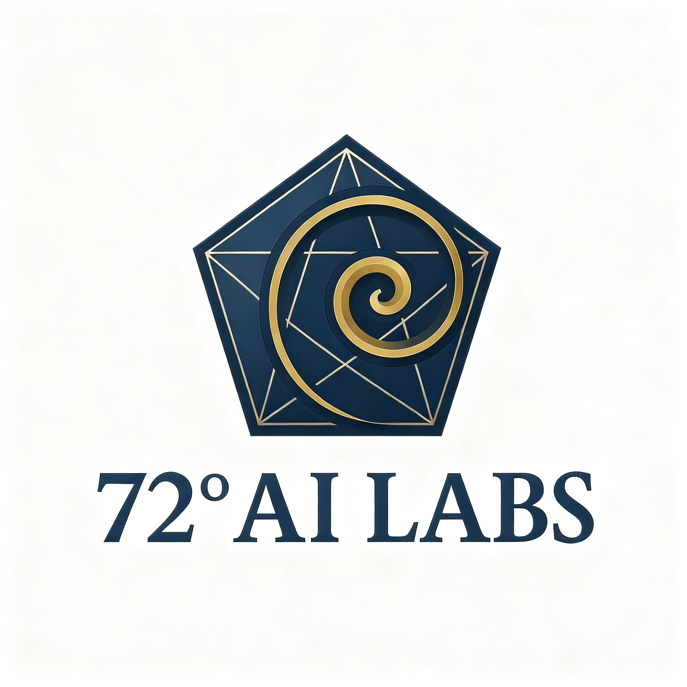

# 72° AI LABS: brand kit

This page holds the logo and its rules. Colour and type detail lives in `DESIGN.md` at the repo root, and the voice lives in `brand-voice.md` in `mandar-gite/72ai-marketing`. When this page and those files disagree, they win.

### 1. Logo

- **Main logo:** `public/logos/logo_ver3.3_1x1.jpg` (version 3.3, square, 2048 x 2048 px). This replaces version 2.1.
- **Mark only:** `public/logos/logo-mark.png`, for small sizes such as the site header and favicons.
- The wordmark is a serif bold, and it exists only inside the logo artwork. Don't set "72° AI LABS" in a serif anywhere else.

### 2. Colour

The 3 brand colours:

| Name | Hex | Use |
|---|---|---|
| Midnight Navy | `#0C1A3F` | The logo navy. Small solid surfaces: step discs, metric cards, the skip link. |
| Logo Gold | `#DDA744` | Inside the logo only. |
| Pentagon Gold | `#D9A441` | The one accent on the site. Dots, rules, hover edges, numerals. Never body text. |

Supporting colours on the site:

| Name | Hex | Use |
|---|---|---|
| Large-Text Gold | `#B8872B` | Gold text at 24px and up (3.2:1 on white) |
| Burnished Gold | `#C4902E` | Hero accent words at display size only (2.85:1 on white) |
| Softened Ink | `#1A2238` | Headings, button text, borders |
| Slate Body | `#5B6472` | Body copy, nav links, card text |
| Quiet Caption | `#8A93A3` | Uppercase labels and captions |
| Canvas White | `#FFFFFF` | Page and card background |
| Cool Mist | `#F6F7F9` | Alternate section bands |

- Backgrounds are white. The old cream (`#F2E9D8`) is retired.
- Keep gold to about 5% of any screen. It's the only accent colour.
- For print, get exact CMYK values from a print shop. Earlier CMYK figures in this file were estimates.

### 3. Type

- **Everything except the wordmark:** Plus Jakarta Sans, falling back to Inter, then the system sans-serif.
- Build hierarchy with weight (800, 700, 400) and letter spacing. Don't add a second typeface.
- Sizes and spacing for each text style are in `DESIGN.md` under "Typography".

### 4. Logo usage

- **Minimum size:** 144 px wide on screen, 1.5 inches in print.
- **Clear space:** at least 1/4 of the logo's height on every side. Keep other graphics and text out of it.
- **Colour versions:**
  - Full colour on white or light backgrounds.
  - White or light gold on dark backgrounds.
  - Navy or black on light backgrounds when colour isn't available.
- **Never:** stretch or distort it, change its colours (apart from the versions above), add filters or shadows, rearrange its parts, or place it on a busy background.

### 5. Imagery

- **Photos:** clean and modern, with muted colour that sits well next to navy and gold. Themes: technology, precision, problem-solving.
- **Graphics:** echo the pentagon's straight lines or the spiral's curve. Keep them simple.

### 6. Voice

The voice is in `brand-voice.md` in `mandar-gite/72ai-marketing`. In short: specific, plain, honest about limits, and proof first. It replaces this file's earlier tone section ("formal", "cutting-edge").
