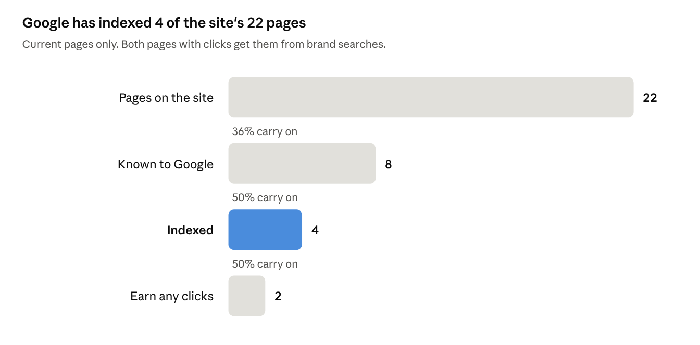

# 72ai.in SEO and Brand Review

Oct 20, 2026 · Mandar Gite

Shared doc: https://claude.ai/code/artifact/e218cd5d-92d9-410a-ad12-baece2f0e53e (this file is a copy as of the date above; the doc may have moved on).

72ai.in has a sound technical base but almost no search presence: Google knows 8 of its 22 pages and has indexed 4, and all 23 search clicks so far came from brand searches. Release 0.9.0 fixes the crawl and on-page issues; the gap that remains is content depth, internal linking and authority. This review asks for expert input on the plan below.

## Where the site stands

| Stage | Pages | Carry on |
| --- | --- | --- |
| Pages on the site | 22 | |
| Known to Google | 8 | 36% |
| Indexed | 4 | 50% |
| Earn any clicks | 2 | 50% |

Source: Google Search Console, domain property, as of 2026-10-20 · the 22 pages in release 0.9.0.

The biggest loss comes before ranking: 14 of the 22 pages were never discovered, and no sitemap has been submitted. The 4 indexed pages are the homepage, 2 blog posts and 1 project page.

## Fixed in release 0.9.0

Four changes merged to `develop` on 2026-10-20; the release PR to `main` is open and ships on merge. Each fix carries an automated test that runs against the built site.

| Area | Before | After | Evidence |
| --- | --- | --- | --- |
| Sitemap | 28 URLs: `/about`, `/projects`, `/solutions` listed twice, 2 noindex pages, 1 redirect page, every `lastmod` set to the build time | 22 URLs, each 200, self-canonical and indexable; no `lastmod` | Spec fails on any duplicate, noindex, redirect or non-self-canonical entry |
| Canonical | `/careers` canonical pointed at a URL that 301s | Self-canonical `/careers/` | Same spec |
| Project titles | Bare product names, e.g. "CallMind \| 72° AI Labs" | Buyer terms, 48 to 60 chars, e.g. "CallMind: AI Call Compliance Scoring for Hindi" | Spec checks pattern, length and uniqueness on all 10 pages |
| Project descriptions | 46 to 108 chars, reused the visible tagline | 131 to 157 chars, separate field, facts from the page only | Same spec |
| Brand in titles | "72° AI Labs" and "72° AI LABS" mixed | "72° AI LABS" in every title; long blog H1 gets a 56-char search title | Spec on every page |
| Organization schema | `sameAs` empty | Company and founder LinkedIn pages | Spec parses the JSON-LD |
| Fonts | 6 Inter weights loaded, never rendered | Inter dropped; Plus Jakarta Sans only | Browser check of computed fonts on 6 pages |
| Contrast | 31 WCAG AA failures across 23 pages (gold #DDA744 at 2.2:1, grey #94A3B8 at 2.6:1) | Ink text, navy on gold badges, a 3.2:1 gold for 24px+ text only | Spec computes contrast for every visible text node; Lighthouse accessibility 94-96 → 100 |
| Heading order | `/projects` jumped from H1 to H3 | Screen-reader H2 above the grid | Spec on `/projects` |
| Images | 3 chart PNGs, 404 KB, up to 2,779 px wide for an 800 px column | 1,600 px lazy WebP, 72 KB | Spec checks format, size and lazy loading |

Test suite on the release branch: 237 end-to-end tests and 29 unit tests pass. An independent pre-landing review found no blocking issues.

## Open SEO findings

The biggest remaining issues are a 301 on almost every internal link, thin project pages and no sitemap ever submitted. Severity is our judgment of ranking impact.

| Finding | Detail | Severity | Proposed fix |
| --- | --- | --- | --- |
| Slashless internal links | Nav, footer and cards link to `/projects`, `/blog`, `/solutions`, `/about`, `/privacy`; GitHub Pages 301s each to the slash form. Counted in the build: `/projects` 99, `/blog` 78, `/solutions` 77, `/about` 76, `/privacy` 50. Search Console reports the slashless URLs. | High | Trailing slash on every internal href, canonical and JSON-LD URL |
| Sitemap never submitted | Search Console shows 0 submitted sitemaps; 14 of the 22 pages were never discovered | High | Submit after the 0.9.0 deploy, request indexing for 8 pages |
| Thin project pages | 10 pages hold 73 to 213 words in `<main>`; 2 of them (CallMind, NextSurge) were crawled and not indexed | High | Problem, approach, stack, results and limits sections, 400+ words, verified facts only |
| Project pages are dead ends | Each links only back to `/projects`; no sibling projects, no link to the matching solution area | Medium | Related-projects block by category, plus a link to `/solutions/#area` |
| Blog posts don't link into the work | Each post body links only to `/#contact`; the free Voice DNA tool and `/about` get no in-content links | Medium | 2-3 contextual links per post |
| No project schema | Blog posts carry BlogPosting, BreadcrumbList and FAQPage; project pages carry none | Low | BreadcrumbList and CreativeWork |
| Stale publishing | 3 posts in total; the last on 2026-04-14 | Medium | A post every 2 weeks from the gap list below |
| Authority | 1 external backlink (linkedin.com) | Medium | Directory listings, alumni network, guest posts |
| HSTS | Header not sent | Low | Enable at Cloudflare |

## Keyword opportunities

The best openings are narrow, question-shaped and India-specific terms where only vendor pages or listicles rank today. Demand and difficulty are estimates from who ranks for each term, not measured volumes; the site ranks for none of these yet.

| Keyword | Intent | Est. difficulty | Opportunity | Content type |
| --- | --- | --- | --- | --- |
| is it safe to upload financial data to ChatGPT | Informational | Easy | High | Question post |
| AI proof of concept: what to expect | Informational | Easy | High | Process page |
| custom AI cost for small business (INR) | Commercial | Moderate | High | Pricing guide |
| private LLM India, DPDP data residency | Informational | Easy | High | Explainer |
| on-premise LLM for business | Commercial | Moderate | High | Pillar guide |
| self-hosted LLM vs ChatGPT for business | Commercial | Moderate | High | Comparison |
| GST reconciliation automation with Tally | Commercial | Moderate | High | Guide linked to a Tally project |
| AI for Tally | Commercial | Moderate | High | Solution section |
| AI call compliance / call recording analysis | Commercial | Easy | Medium | Deeper project page |
| handwritten exam sheet OCR | Informational | Easy | Medium | Deeper project page |
| cap table liquidation waterfall tool | Commercial | Easy | Medium | Deeper project page |
| local LLM GPU cost India | Informational | Easy | Medium | Cost guide |
| RAG vs fine-tuning | Informational | Moderate | Medium | Decision guide |
| AI automation company Mumbai | Transactional | Easy | Medium | Local page |
| what is RAG for small business | Informational | Moderate | Low | Explainer with FAQ |
| AI for SMEs India | Informational | Hard | Low | Pillar, later |

Search Console's only non-brand signals so far are local: "companies in mumbai" and "companies in equinox business park kurla", 2 and 1 impressions.

## Competitors

Publishers with high volume own these terms. None of the pages reviewed carried a named SME case study with measured results, which is where 72ai's project pages can compete once they're deeper.

| Site | What it ranks or publishes | Depth and cadence | Formats |
| --- | --- | --- | --- |
| [aiaccountant.com](https://www.aiaccountant.com/blog) | Tally-linked product; GST reconciliation, handwritten invoices in Tally, AP automation | About 1 post a day in Sep 2026; 30 posts on the first blog page | Guides, templates, Tally tutorials, comparisons, free tools; no case studies |
| [opsiocloud.com/in](https://opsiocloud.com/in/knowledge-base/what-is-rag-india-guide/) | "What is RAG" India guides; DPDP, RBI, SEBI angles | About 1,260-word guides with FAQ and takeaway boxes; cadence unverified | Knowledge-base guides, INR pricing |
| [suvit.io](https://www.suvit.io/post/gst-reconciliation-automation-with-tally) | GST reconciliation automation with Tally | Not measured | Product-led how-tos |
| [team400.ai](https://team400.ai/blog) | SME RAG and Copilot questions (Australia; a format benchmark, not a rival) | About 221 posts Jul to Oct 2026, template-driven | How-tos, decision guides, comparisons |
| 72ai.in | Brand terms only | 3 posts; 1 deep post (2,800 words); project pages 73-213 words | Project write-ups with real figures, 2 free tools |

Cost-guide formats that likely hold snippets for RAG cost terms: [RaftLabs](https://www.raftlabs.com/blog/rag-development-cost) and [SoluLab](https://www.solulab.com/rag-development-cost/). Snippet and People Also Ask ownership is inferred, not observed.

## Brand review

The site tells 2 stories about what the studio does. Solutions shows 4 practice areas, each backed by a built project; the homepage promises 6 domains, including Sales, Customer Support, Marketing and Logistics, where no project exists. Copy was checked against the studio's written voice rules (contractions, digits, specific claims, no em dashes, no "isn't X, it's Y" framing).

| Finding | Where | Severity | Proposed fix |
| --- | --- | --- | --- |
| 6 promised domains vs 4 practice areas; "Answer every customer query in seconds" has no evidence | Homepage "What we build" | High | Match the 4 areas, link each card to a project |
| 3 legacy service names, repeated in the LocalBusiness schema | About "What We Do", site JSON-LD | High | Replace with the 4 practice areas in both |
| "X, not Y" framing, banned by the voice rules | About (2 lines), Careers, 1 blog post | High | Keep the positive claim, drop the negation |
| Founder bio claims beyond shown work ("pricing that adapts", "field operations") | About | Medium | Name only work a project shows |
| Em dashes in copy, 2 of them in search snippets | 7 pages | Medium | Commas, colons or parentheses |
| Filler and banned words ("robust", "advanced", "real-time", "deep dive", "cutting-edge") | Solutions intros, 1 project tagline, 2 blog posts | Medium | Name the actual tasks, as the Finance intro does |
| Old brand spelling "72° AI Labs" in body copy | 3 blog posts (6 times) | Medium | "72° AI LABS" |
| Title Case headings where the rest of the site uses sentence case | About | Low | Sentence case |

**Compliance flags**

- **Unsupported service claims:** support assistants, deal prediction, marketing attribution and shipment delay prediction appear on the homepage with no project behind them.
- **Trading signals:** NextSurge shows models that produce trading signals. In India, publishing signals can look like research-analyst activity under SEBI rules. Proposed line: "Research project. Not investment advice, and not offered as a signal service."
- **Unconfirmed industries:** "Built for Manufacturing, Food & Beverage, Retail & Distribution, Professional Services, Logistics" is not yet backed by named work in each.
- **Client permission:** 2 project pages describe client contexts without naming the client; written permission is still to be confirmed.
- **Done well:** Valent states it does not estimate fair market value, and Farm Wildlife Alerts is labelled "In development".

## Next steps

Crawl access comes first, then link structure, then content; content is the slowest and needs the founder's verified facts.

1. **Deploy 0.9.0**, submit the sitemap, request indexing for 8 pages, and rerun Lighthouse on the live site.
2. **Next release (planned, 4 tasks, each test-first):**
    1. Trailing slash on every internal URL, canonical and JSON-LD URL.
    2. Related projects and a solution-area link on each project page.
    3. BreadcrumbList and CreativeWork schema on project pages.
    4. Contextual links from the 3 blog posts and the homepage; "cap table" into the Valent page's opening.
3. **Brand fixes:** align homepage and About to the 4 practice areas; remove the banned framing and em dashes; add the NextSurge disclaimer.
4. **This quarter, content:** deepen the 10 project pages (400+ words each, starting with the 2 Google crawled and dropped), publish an INR pricing and "what a PoC looks like" page, then one post every 2 weeks: private LLM and DPDP, self-hosted LLM vs ChatGPT, RAG vs fine-tuning, a Tally/GST cluster, a Mumbai page.
5. **Authority:** directory listings, alumni network, guest posts.
6. **Measure again** once Ahrefs or Keyword Planner data is available.

## Questions for reviewers

1. **Priority:** with 8 of 22 pages known to Google and 1 backlink, would you put authority work ahead of new content, or after the project pages are deeper?
2. **Project pages:** is 400+ words the right target for B2B proof-of-work pages, and which sections would you require (problem, approach, stack, results, limits)?
3. **Keyword bets:** of the high-opportunity terms, which 3 would you write first for an Indian SME buyer who runs on Tally?
4. **Positioning:** should the homepage narrow to the 4 practice areas, or keep a wider industry promise to catch broader searches?
5. **Compliance:** is a disclaimer line enough for the trading-signal project, or should it come off the public site?
6. **Local search:** is a Mumbai page worth it for a studio that sells globally?

## Method and sources

All data was gathered on 2026-10-20. The paid SEO tool (Ahrefs) refused every request on the current plan, so there are no measured search volumes, difficulty scores or backlink metrics in this review.

| Source | What it gave | Limits |
| --- | --- | --- |
| Google Search Console (domain property) | Indexing status, 16 months of queries and pages, links | Low traffic: no Core Web Vitals field data |
| Built site (release 0.9.0) | Titles, descriptions, headings, word counts, internal links, schema, for 22 pages | Word counts include card and button text in `<main>` |
| Live site | Status codes, redirects, headers | Still on the previous release until deploy |
| Lighthouse 12.8.2 | Performance, SEO and accessibility scores on 5-7 pages, mobile and desktop | Lab data; local runs read slower than the CDN |
| Web search | Keyword landscape and competitors | Estimates; SERP features inferred, not observed |
| Studio voice rules and product brief | Brand review criteria | Internal documents |

Competitor pages opened: [AI Accountant blog](https://www.aiaccountant.com/blog), [Opsio RAG India guide](https://opsiocloud.com/in/knowledge-base/what-is-rag-india-guide/), [Suvit GST reconciliation](https://www.suvit.io/post/gst-reconciliation-automation-with-tally), [Team400 blog](https://team400.ai/blog), [RaftLabs RAG cost](https://www.raftlabs.com/blog/rag-development-cost), [SoluLab RAG cost](https://www.solulab.com/rag-development-cost/).
